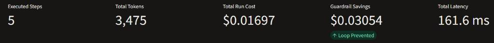
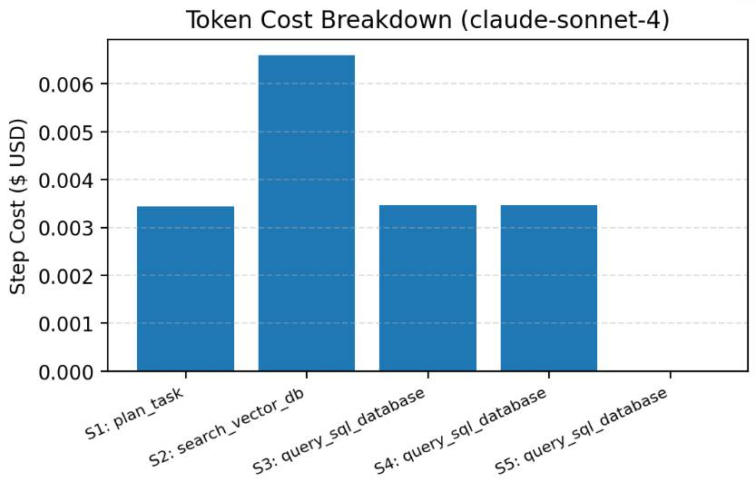
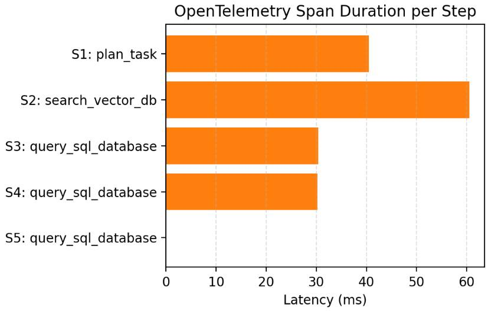
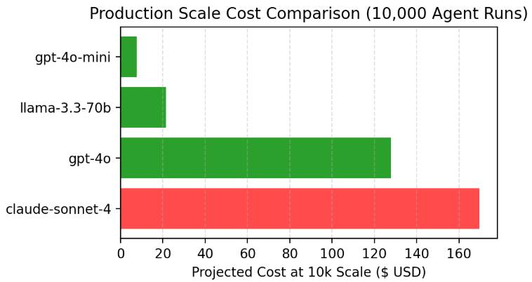

# AI Agent Observability: Cost, Latency & Loop Circuit-Breaker

An **OpenTelemetry-instrumented** observability wrapper and **Streamlit** telemetry dashboard for autonomous AI agents — tracking per-step token spend, span latency, multi-model production cost projections, budget caps, and automatically halting infinite tool-call loops.

## Features
- **OpenTelemetry Span Tracing (`tracer.py`):** `@tracker.trace_step(...)` decorator recording `gen_ai.usage.input_tokens`, `gen_ai.usage.output_tokens`, `agent.cost_usd`, and span durations, with one-click JSON trace export.
- **Infinite-Loop Circuit Breaker:** Detects repeated identical `(tool, arguments)` signatures and halts runaway execution before burning API credits.
- **Multi-Model Scale Projection & Budget Guardrails:** Benchmarks run costs at 10,000-execution scale across `Claude Sonnet 4`, `GPT-4o`, `Llama-3.3-70B`, and `GPT-4o-mini` while enforcing hard USD spend caps.

## Visual Preview

### 1. Live Run KPIs & Guardrail Savings


### 2. Per-Step Token Cost Attribution


### 3. OpenTelemetry Span Latency Waterfall


### 4. Production Scale Cost Projection (10,000 Runs)


## Quickstart
```bash
pip install -r requirements.txt
python -m streamlit run app.py
```
